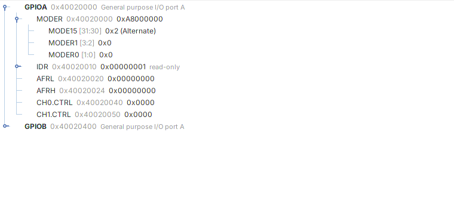
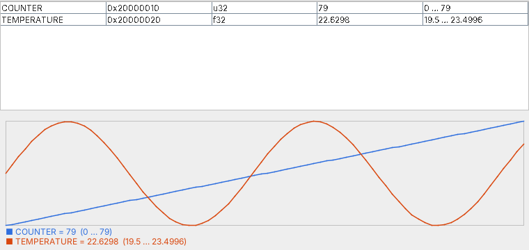

# probe-rs for RustRover

A RustRover plugin that debugs embedded Rust through [probe-rs](https://probe.rs): click **Debug** on a Cargo
configuration of your firmware, and it gets flashed, stops at your breakpoints, streams its defmt logs into a tab of
their own, and shows the chip's registers decoded from its SVD file.

I used to do my embedded work in CLion, with its embedded debugger. RustRover has no way to talk to a debug probe
(JetBrains' issue [RUST-12476](https://youtrack.jetbrains.com/issue/RUST-12476) asks for probe-rs support), and the only
debugger front end for `probe-rs dap-server` is the VS Code extension. This plugin adds one to RustRover.

**Status:** it works on my desk, which is an Arduino MKR WiFi 1010 (ATSAMD21G18A) behind a cheap CMSIS-DAP probe, with
probe-rs 0.32 and RustRover 2026.3 on Linux. Other chips, probes and operating systems haven't seen it yet, so YMMV and
caveat emptor. [`docs/verification.md`](docs/verification.md) lists what ran on hardware and what only ran in tests.

## What you get

- **Debugging through probe-rs** for Cargo run configurations, picked up from the `probe-rs run --chip …` runner in
  `.cargo/config.toml` that most embedded templates already have: breakpoints, stepping, variables and hovers in
  RustRover's own debugger, and flashing with a progress bar (only changed flash sectors are reprogrammed).
- **RTT tabs**, one per channel, with defmt levels colored, `src/main.rs:42` locations clickable, a level filter, and an
  input line for the target's down channel. `probe-rs run` output in the **Run** window gets the same colors and links.
- A **probe-rs tab** in the debug session with what RustRover's Variables view leaves out: the CPU registers, the chip's
  peripherals from its SVD file, and statics. Field values are decoded from the SVD (`PMUXE` shows **G**, "Peripheral
  function G selected", not `0x6`), and pin registers show pins (`DIR0` on a SAM chip shows **PA20**, `GPIO_OUT` on an
  RP2040 **GPIO25**). Changed values are highlighted after each step, and statics and registers go to Live Watch with a
  right-click.
- **SVD files** are found online on request, from the Rust PAC projects (atsamd-rs, rp-rs) or
  [cmsis-svd-data](https://github.com/cmsis-svd/cmsis-svd-data), and stored in the project.
- A **Peripherals** tool window to browse and edit registers and fields, and **Live Watch** to chart globals or
  addresses while the target runs.
- **Errors with a fix attached:** no probe, several probes ("Use this probe"), USB permissions (the udev command), an
  unknown chip, locked flash, and so on.
- Also: Attach to Running Target, a remote probe-rs server, settings per run configuration, core dumps, a Wokwi debug
  configuration, and Tools → probe-rs → **Copy probe-rs Diagnostics** for bug reports.

<p>
  <br>
  <br>
  <br>
  
</p>

These are rendered headlessly by the `*InRustRoverTest` tests, with made-up data; the real thing has icons.

## Getting started

You need RustRover 2026.3 or later and probe-rs 0.24 or later (`cargo binstall probe-rs-tools`, or Tools → probe-rs →
Install or Update probe-rs from the IDE). On Linux, the probe also needs probe-rs's udev rules; the plugin offers the
command when it runs into a permission error.

1. Build the plugin with `./gradlew buildPlugin` and install `build/distributions/probe-rs-rustrover-0.1.0.zip` via
   Settings → Plugins → ⚙ → Install Plugin from Disk.
2. Open a firmware project whose `.cargo/config.toml` has a probe-rs runner, e.g.:

   ```toml
   [target.'cfg(all(target_arch = "arm", target_os = "none"))']
   runner = "probe-rs run --chip ATSAMD21G18AU"
   ```

3. Click **Debug** on the `fn main` gutter icon. The first session offers to download the chip's SVD file.

Note that updates need an IDE restart: finished debug sessions keep their tabs (and RustRover keeps the driver that
started them), so the plugin can't be unloaded cleanly while any of them is open.

## How it works

```
Cargo Debug ─▶ RsDebugRunner ─▶ ProbeRsDriverConfigurationProvider (org.rust.debugger.driverConfigurationProvider, first)
                                   └─ ProbeRsDriverConfiguration (RustRover's DapDriverConfiguration; launch or attach)
                                        └─ RelayMain child process ──stdio──▶ probe-rs dap-server [--host …]
                                              ⇅ side channel (loopback socket + token)
                                           ProbeRsSessionUi / ProbeRsSessions:
                                             RTT and probe-rs tabs · progress · notifications
                                             Peripherals, Live Watch, RTT input, core dumps ─▶ DAP requests via the relay
```

RustRover already speaks the Debug Adapter Protocol, and probe-rs has a DAP server, so most of the work happens in a
small relay that sits between the two. It exists because the two don't quite agree on a number of things:

- RustRover drops probe-rs's own events (RTT channels and data, messages), so the relay answers probe-rs's RTT handshake
  and forwards the data to the IDE over a side channel.
- RustRover doesn't announce progress support, so probe-rs only printed `FLASHING:` lines; the relay asks for progress
  events on its behalf.
- RustRover sends hovers and watches without an `evaluate` context, which probe-rs answers with
  `<invalid expression "led">`; the relay adds one.
- RustRover only shows the locals scope, and the first scope with hint `registers` as its Registers node. probe-rs gives
  that hint to the SVD peripherals as well (and lists them first), so the relay renames it, and the probe-rs tab shows
  the remaining scopes.
- RustRover asks for the stack and the scopes twice on every stop, and over a slow probe each answer costs 130 to
  150 ms; the relay answers the repeats from a cache.
- Tool windows have no way to send their own DAP requests, so the relay sends them (memory reads and writes, RTT input,
  scopes) with sequence numbers of its own, and holds them back until probe-rs has launched.

The relay also keeps the last session's traffic in `log/probe-rs/last-session.log` of the IDE's log directory, which is
where most of the above was found.

Per-run-configuration settings live in the project's probe-rs settings, keyed by configuration name: Cargo run
configurations don't persist plugin data, and the Rust plugin doesn't tell the debugger extension point which
configuration it is debugging (`ProbeRsExecutionListener` records the launch instead).

## Limits

- **Statics don't show on hover.** RustRover offers no value tooltip for statics and never asks the debugger; their
  values are in the probe-rs tab and in Live Watch.
- **RustRover's Memory View stays empty** so far; I haven't looked into why.
- **Restart reflashes.** RustRover's restart starts a new session; probe-rs's own `restart` request isn't reachable,
  because the IDE's DAP client sends it, not the plugin.
- **One core at a time:** probe-rs debugs one core per session; the core index is a per-configuration setting.
- **Core dumps can be written, not loaded:** probe-rs's debug server has no request for it.
- **Wokwi goes through GDB,** since Wokwi exposes a GDB server, not a probe. On ESP32 (Xtensa) that needs Espressif's
  GDB in the Rust toolchain settings.
- **Internal API:** the plugin builds on `DapDriverConfiguration`, which JetBrains marks as internal and may change
  without notice. A small public DAP-debugger extension point would fix that; RUST-12476 is the place to ask.

## Development

```bash
./gradlew test                          # unit tests and end-to-end relay tests (needs python3)
./gradlew test -PplatformTests=true     # adds the headless RustRover tests and screenshots (build/screenshots)
./gradlew verifyPlugin                  # Plugin Verifier (RustRover and CLion 2026.3)
./gradlew buildPlugin                   # build/distributions/probe-rs-rustrover-0.1.0.zip
./gradlew publishLocalRepo              # 0.1.0.<date>.<time> into a local plugin repository, see below
./gradlew runIde                        # a sandboxed RustRover with the plugin
```

By default the build downloads RustRover 2026.3 and a Java 25 toolchain. To build against a local install instead, set
`rustRoverPath` in `~/.gradle/gradle.properties` (or pass `-PrustRoverPath=…`); `verifyPlugin` then runs offline against
it.

**Local plugin repository:** `publishLocalRepo` writes the zip and an `updatePlugins.xml` to
`~/.local/share/probe-rs-rustrover/plugin-repo/` (or `-PlocalPluginRepo=…`). Add
`file:///home/<you>/.local/share/probe-rs-rustrover/plugin-repo/updatePlugins.xml` once under Settings → Plugins → ⚙ →
Manage Plugin Repositories, and each `publishLocalRepo` shows up as an update of the installed plugin.

**CI** (`.github/workflows/build.yml`) runs the tests, the Verifier and the build on every push. For a tag `v0.1.0` it
signs and publishes to the Marketplace once the repository secrets `CERTIFICATE_CHAIN`, `PRIVATE_KEY`,
`PRIVATE_KEY_PASSWORD` and `PUBLISH_TOKEN` are set.

Research notes and the original plan are in [`docs/plan.md`](docs/plan.md). When something fails on your board,
Tools → probe-rs → **Copy probe-rs Diagnostics** collects versions, detection, the launch configuration and the last
session's DAP traffic (never the remote server's token); please include it in the issue.
