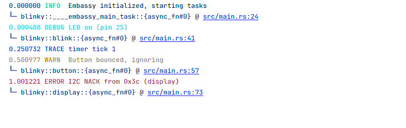
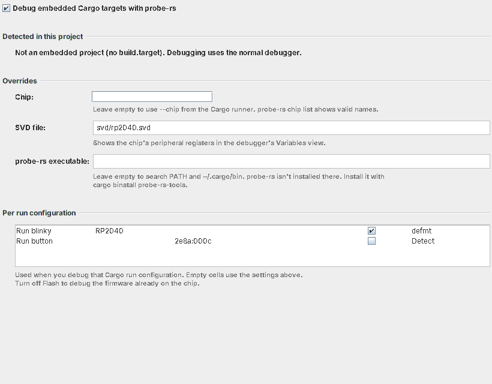

# probe-rs for RustRover

Click **Debug** on a Cargo configuration in an embedded Rust project, and RustRover debugs through
`probe-rs dap-server` instead of GDB/LLDB. The firmware is flashed, defmt/RTT logs get their own tab, the chip's
registers show up in a Peripherals view, and globals can be watched live. Research and roadmap: [`docs/plan.md`](docs/plan.md).

**Status: first hardware runs.** Debug launch, flashing progress and defmt RTT logs work on a real board (Arduino MKR
WiFi 1010, ATSAMD21G18A, through a CMSIS-DAP probe, probe-rs 0.32.0, licensed RustRover 2026.3). Everything else was
tested against RustRover 2026.3 (263.7307.214) without a board. See [What's verified](#whats-verified).

## Features

| Feature | Where | Verified how |
|---|---|---|
| probe-rs debugging for Cargo configurations, detected from the `probe-rs run --chip …` runner | Debug button / gutter | Headless RustRover: provider loads and runs before the stock GDB/LLDB one |
| Breakpoints, stepping, variables, disassembly, memory, registers | RustRover's debugger UI, fed by probe-rs | **Not verified** (needs a board) |
| **RTT tab per channel**: defmt levels colored, `src/main.rs:42` clickable, minimum-level filter, clear/wrap/scroll actions, **input line** to the target's RTT down channel | Debug tool window | **Hardware:** defmt logs in the RTT tab. Relay and side channel end to end (fake probe-rs); console headless |
| defmt colors and links in **Run** output (`probe-rs run`) | Run tool window | Console filter, headless |
| **Peripherals**: SVD tree (derivedFrom, clusters, arrays, enums), values read when expanded, refreshed on halt or live, changes highlighted, **edit** registers and fields (read-modify-write) | Peripherals tool window | SVD parser and decoding tests; panel against fake memory; memory reads/writes end to end |
| **Live Watch**: globals by name (from the firmware's symbol table) or address, sampled while running, **chart** with min/max | Live Watch tool window | ELF reader (synthetic ELF), decoding, panel against a fake target |
| Flashing progress in the IDE progress bar; only changed flash reprogrammed | Status bar | **Hardware.** Relay and side channel end to end |
| probe-rs errors as notifications with a fix: no probe, several probes (**"Use this probe"** actions), busy, USB permissions (**udev command**), unknown chip, connect under reset, locked flash | Notifications | Advisor tests against probe-rs's own error texts |
| **Attach to Running Target** (no flashing, no reset: DAP `attach`) | Run menu | Driver configuration test |
| Settings: chip (**completion** from `probe-rs chip list`), **probe picker** (`probe-rs list`), SVD file (found in the project), **remote probe-rs server** (token in the password safe), and overrides **per run configuration** (chip, probe, SVD, core, flash, RTT) that follow renames | Settings → Build, Execution, Deployment → probe-rs | Headless: apply/reset, renames, fake `probe-rs` executable |
| **Install or update probe-rs** (cargo binstall / install), version check, one-time "embedded project detected" notification | Tools → probe-rs, notifications | Command construction; startup code compiled, not exercised |
| **Save Core Dump** (registers + RAM from `probe-rs chip info`) | Tools → probe-rs | Parser test; the `dump` command itself not exercised |
| **Copy probe-rs Diagnostics**: versions, detection, launch JSON, last session's DAP traffic, never the remote token | Tools → probe-rs | Headless test, token check |
| **Wokwi simulator**: creates a RustRover Remote Debug (GDB) configuration from `wokwi.toml` for the Wokwi plugin's GDB server | Tools → probe-rs | Headless: configuration created and serialized |
| embedded-test crates detected; `cargo test` through the probe-rs runner feeds RustRover's test tree | Settings, test gutter | Detection test; probe-rs accepts IntelliJ's libtest flags (from its source) |

<p>
  <br>
  <br>
  <br>
  
</p>

Rendered headlessly by the `*InRustRoverTest` tests. The offscreen renderer leaves out icons, the chip completion
field and the settings table's header and toolbar; they should appear in the real IDE.

## How it works

```
Cargo Debug ─▶ RsDebugRunner ─▶ ProbeRsDriverConfigurationProvider (org.rust.debugger.driverConfigurationProvider, first)
                                   └─ ProbeRsDriverConfiguration (RustRover's DapDriverConfiguration; launch or attach)
                                        └─ RelayMain child process ──stdio──▶ probe-rs dap-server [--host …]
                                              ⇅ side channel (loopback socket + token)
                                           ProbeRsSessionUi / ProbeRsSessions:
                                             RTT tabs · progress · notifications
                                             Peripherals, Live Watch, RTT input, core dumps ─▶ DAP requests via the relay
```

RustRover's DAP client drops probe-rs's custom events and standard progress events, and gives plugins no way to send
their own requests. The relay sits between the two: it answers probe-rs's RTT handshake, forwards RTT data, progress and
messages to the IDE over a side channel, and turns IDE commands (read/write memory, evaluate, RTT write) into DAP
requests with its own sequence numbers. It also keeps the last session's traffic for diagnostics.

Per-run-configuration settings live in the project's probe-rs settings, keyed by configuration name: Cargo run
configurations don't persist plugin data, and their editor has no room for extension tabs. The Rust plugin's debugger
extension point isn't told which configuration it is debugging, so `ProbeRsExecutionListener` records the launch.

## What's verified

- **On hardware** (Arduino MKR WiFi 1010, ATSAMD21G18A, CMSIS-DAP probe, probe-rs 0.32.0, licensed RustRover 2026.3,
  Linux): the plugin loads in the production IDE, Debug on a Cargo example launches through the relay, the firmware is
  flashed with a progress bar, and defmt logs show up decoded in the RTT tab. The project was detected with the real TOML
  parser, so the production IDE gives access to the `visibility="internal"` modules the plugin builds on.
- **Compiles and loads** against RustRover 2026.3, including the `visibility="internal"` modules it builds on (test mode).
- **85 tests:** parsers (Cargo/TOML, defmt, SVD, ELF, probe-rs output, wokwi.toml), launch JSON (field names from
  probe-rs's source), error advice, register and watch decoding, relay routing and commands, **five end-to-end runs of
  the relay as a real child process** against a scripted fake `probe-rs dap-server` (RTT, progress, failed launch,
  memory read/write, RTT input, trace log), and headless RustRover tests for plugin loading, settings, run
  configurations, Peripherals, Live Watch, Wokwi, the probe-rs CLI wrapper, diagnostics and screenshots.
- **Plugin Verifier:** compatible with RustRover 2026.3; 12 usages of internal API, all in `DapDriverConfiguration`.

**Not verified:** breakpoints and stepping, how probe-rs's values, registers and peripherals look in RustRover's
debugger, the Peripherals and Live Watch views with real silicon, RTT input, attach, core dumps, other chips and probes,
Wokwi with a real simulation, the test tree for embedded-test, installing probe-rs, macOS and Windows. CI and
Marketplace publishing are configured but haven't run.

## Not possible, or not done

- **Restart:** RustRover's restart starts a new session, which reflashes (only changed sectors, with the default
  setting). probe-rs's own `restart` request isn't reachable, because the IDE's DAP client sends it, not the plugin.
- **Several cores at once:** probe-rs debugs one core per session; the core index is a per-configuration setting.
- **Loading a core dump to debug it:** probe-rs's debug server can write core dumps but not load them.
- **Wokwi through probe-rs:** Wokwi exposes a GDB server, not a probe, so it goes through RustRover's GDB debugger. On
  ESP32 (Xtensa) that needs Espressif's GDB set in the Rust toolchain settings.
- **Marketplace vendor details:** the vendor is "Markus Mayer"; add a public `url` or `email` to the `vendor` tag in `plugin.xml` if you want them on the Marketplace page.

**Main risk:** `DapDriverConfiguration` is marked internal. JetBrains may change it without notice, and Marketplace
review may object. Worth asking on RUST-12476 for a small public DAP-debugger extension point.

## Running

```bash
./gradlew test                          # unit and end-to-end relay tests
./gradlew test -PplatformTests=true     # adds the headless RustRover tests and screenshots (build/screenshots)
./gradlew verifyPlugin                  # Plugin Verifier (RustRover and CLion 2026.3)
./gradlew buildPlugin                   # build/distributions/probe-rs-rustrover-0.1.0.zip
./gradlew publishLocalRepo              # 0.1.0.<date>.<time> into a local plugin repository, see below
```

**Local plugin repository:** `publishLocalRepo` writes the zip and an `updatePlugins.xml` to
`~/.local/share/probe-rs-rustrover/plugin-repo/` (or `-PlocalPluginRepo=…`). Add
`file:///home/<you>/.local/share/probe-rs-rustrover/plugin-repo/updatePlugins.xml` once under Settings → Plugins → ⚙ →
Manage Plugin Repositories; after that each `publishLocalRepo` shows up as an update of the installed plugin.

By default the build downloads RustRover 2026.3 and a Java 25 toolchain (RustRover 2026.3 runs on Java 25). To use a
local install instead, set `rustRoverPath` in `~/.gradle/gradle.properties`, or pass `-PrustRoverPath=…`. With a local
install, `verifyPlugin` runs offline against it. The end-to-end tests need `python3`.

**CI** (`.github/workflows/build.yml`) runs the tests, the Verifier and the build on every push. For a tag `v0.1.0` it
signs and publishes to the Marketplace once these repository secrets are set: `CERTIFICATE_CHAIN`, `PRIVATE_KEY`,
`PRIVATE_KEY_PASSWORD`, `PUBLISH_TOKEN`.

## Trying it on hardware

1. Install the zip from `buildPlugin` into RustRover 2026.3 (Settings → Plugins → ⚙ → Install Plugin from Disk).
2. Open a project whose `.cargo/config.toml` has a runner like `probe-rs run --chip RP2040`.
3. Click **Debug** on the `fn main` gutter icon. Expect a "Flashing device" progress bar, then an **RTT** tab next to
   the debugger's Console. Open **Peripherals** (needs an SVD file) and **Live Watch** from the tool window bars.
4. If something fails: Tools → probe-rs → **Copy probe-rs Diagnostics**, and include it in the report.
